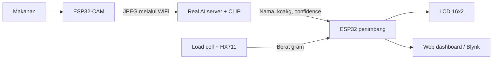

# AI-Based Food Nutrition Detection System

Sistem ini menggunakan inferens AI sebenar. ESP32-CAM mengambil gambar makanan dan menghantar JPEG kepada model CLIP pada laptop. ESP32 kedua membaca berat daripada load cell, menerima keputusan AI, mengira kalori, dan memaparkan hasil pada LCD serta dashboard WiFi.

```text
Jumlah kalori = berat makanan (g) x kalori per gram
```

## Aliran Sistem



Tiada `DEMO_MODE` atau keputusan makanan palsu dalam kod semasa. Jika keyakinan AI terlalu rendah, server menolak keputusan dan ESP32 mengekalkan bacaan makanan terakhir.

## Fail Utama

```text
arduino/esp32_cam_detection_sender/esp32_cam_detection_sender.ino
arduino/esp32_scale_nutrition/esp32_scale_nutrition.ino
tools/real_ai_server.py
data/food_calories.csv
requirements-ai.txt
```

## 1. Sediakan AI Server Pada Laptop

Laptop, ESP32-CAM, dan ESP32 penimbang mesti menggunakan rangkaian WiFi yang sama.

### Laptop Baharu (Windows 10/11)

1. Salin seluruh folder projek ini ke laluan pendek, contohnya `C:\AI-Food-Nutrition-System`. Jangan salin satu sketch sahaja kerana AI server juga memerlukan folder `data`, `tools`, dan `requirements-ai.txt`.
2. Pasang [Python 3.12 64-bit](https://www.python.org/downloads/windows/). Dalam installer, tandakan `Add Python to PATH`.
3. Buka PowerShell dalam folder projek dan jalankan sekali sahaja:

```powershell
powershell -ExecutionPolicy Bypass -File .\setup_new_laptop.ps1
```

4. Setiap kali mahu guna sistem, jalankan:

```powershell
.\start_ai_server.ps1
```

Kali pertama server dijalankan, model AI akan dimuat turun. Benarkan Python melalui Windows Firewall pada rangkaian Private jika diminta.

### Pemasangan Manual

Jika skrip PowerShell tidak boleh digunakan, jalankan arahan ini dari folder projek:

```powershell
py -3.12 -m venv C:\food-ai-venv
C:\food-ai-venv\Scripts\python.exe -m pip install --upgrade pip
C:\food-ai-venv\Scripts\python.exe -m pip install -r requirements-ai.txt
C:\food-ai-venv\Scripts\python.exe tools\real_ai_server.py
```

Laluan pendek `C:\food-ai-venv` digunakan kerana PyTorch mempunyai nama fail dalaman yang panjang dan boleh melepasi had laluan Windows jika venv diletakkan di dalam folder projek OneDrive ini.

Kali pertama sahaja, model `openai/clip-vit-base-patch32` akan dimuat turun. Selepas keluar mesej `AI ready`, semak:

```text
http://127.0.0.1:5000/health
http://127.0.0.1:5000/
```

Dashboard AI memaparkan gambar sebenar terakhir, makanan yang dikesan, confidence, dan status diterima atau ditolak.

Cari IPv4 laptop dengan:

```powershell
ipconfig
```

Gunakan IPv4 adapter WiFi, contohnya `192.168.1.10`. Benarkan Python melalui Windows Firewall jika diminta.

## 2. Upload ESP32 Penimbang

Buka:

```text
arduino/esp32_scale_nutrition/esp32_scale_nutrition.ino
```

Isi WiFi yang sama:

```cpp
const char *WIFI_SSID = "NAMA_WIFI";
const char *WIFI_PASS = "KATA_LALUAN_WIFI";
```

Sambungan hardware:

| Modul | ESP32 |
| --- | --- |
| HX711 DT | GPIO 19 |
| HX711 SCK | GPIO 18 |
| LCD SDA | GPIO 21 |
| LCD SCL | GPIO 22 |
| Semua GND | GND bersama |

Upload dan catat `Scale IP` daripada Serial Monitor, contohnya `192.168.1.50`.

## 3. Upload ESP32-CAM

Buka:

```text
arduino/esp32_cam_detection_sender/esp32_cam_detection_sender.ino
```

Isi WiFi, IP penimbang, dan IP laptop:

```cpp
const char *WIFI_SSID = "NAMA_WIFI";
const char *WIFI_PASS = "KATA_LALUAN_WIFI";
const char *SCALE_URL = "http://192.168.1.50/api/food";
const char *AI_SERVER_URL = "http://192.168.0.115:5000/classify";
```

`192.168.0.115` ialah IPv4 laptop yang dikesan semasa sistem ini disediakan. Semak dan ubah semula jika alamat DHCP laptop berubah.

Pilih board `AI Thinker ESP32-CAM`, aktifkan PSRAM jika pilihan itu tersedia, kemudian upload. Kod akan mengambil gambar sebenar setiap 12 saat, menyalakan LED flash, meminta inferens AI, dan menghantar keputusan yang sah kepada ESP32 penimbang.

## 4. Operasi Sebenar

1. Jalankan `real_ai_server.py` dan tunggu `AI ready`.
2. Hidupkan ESP32 penimbang dan lakukan tare tanpa makanan.
3. Hidupkan ESP32-CAM.
4. Letakkan satu jenis makanan di tengah pinggan, dengan pencahayaan jelas.
5. Tunggu AI mengesan makanan dan bacaan berat menjadi `LOCK`.
6. LCD akan memaparkan contoh berikut:

```text
Rice      150g
195 kcal LOCK
```

Dashboard ESP32 penimbang boleh dibuka pada `http://<Scale-IP>/`. Endpoint status ialah `http://<Scale-IP>/api/status`, dan tare boleh dibuat melalui `http://<Scale-IP>/api/tare`.

## Kelas Makanan Dan Kalori

Model membandingkan gambar dengan semua nama dalam `data/food_calories.csv`. Tambah atau ubah makanan di situ, kemudian restart server AI. Nilai ialah anggaran kalori per gram, bukan analisis makmal.

Untuk projek akhir, gunakan kelas yang rupa visualnya jelas dan ambil gambar contoh sebenar bagi setiap kelas untuk menguji threshold. Default server menerima keputusan jika confidence sekurang-kurangnya `0.35` dan beza dengan pilihan kedua sekurang-kurangnya `0.08`.

Threshold boleh dilaras tanpa mengubah kod:

```powershell
python tools\real_ai_server.py --confidence 0.30 --margin 0.05
```

## Blynk Pilihan

Dalam sketch penimbang, tukar `ENABLE_BLYNK` kepada `1` dan isi template/token. Virtual pin: `V0` berat, `V1` kalori, `V2` makanan, `V3` status lock, dan `V4` confidence.

## Batasan Jujur

- CLIP menjalankan klasifikasi imej sebenar, tetapi bukan model yang dilatih khas dengan gambar projek ini.
- Satu imej dianggap mempunyai satu makanan utama; makanan bercampur memerlukan object detection atau segmentation.
- Anggaran kalori bergantung pada nilai CSV dan tidak mengukur protein, lemak, atau karbohidrat secara langsung.
- Untuk ketepatan projek yang lebih tinggi, kumpulkan dataset daripada kamera sendiri dan fine-tune model menggunakan kelas makanan sasaran.
