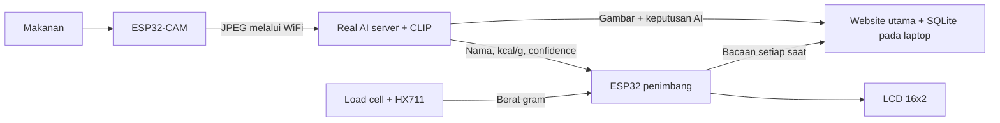

# AI-Based Food Nutrition Detection System

## Website Cloud: Vercel + Postgres + Blob

Versi cloud menggunakan website/API di Vercel, Postgres melalui Vercel Storage (Neon), dan Vercel Blob private untuk gambar. Laptop kekal menjalankan CLIP serta membaca ESP32, kemudian menghantar data keluar melalui HTTPS. Tiada port router perlu dibuka.

Panduan lengkap: [docs/cloud-deployment.md](docs/cloud-deployment.md). Panduan di bawah turut menerangkan mod lokal dan wiring hardware.

- Website cloud: `https://nutritrack-food-nutrition.vercel.app/`
- Jalankan laptop: `.\start_ai_server.ps1 -ScaleUrl "http://IP_PENIMBANG"`.
- Konfigurasi sambungan laptop disimpan dalam `data/cloud-bridge.local.json` dan **tidak dimasukkan ke Git**.
- Rekod/gambar cloud kekal tersedia ketika laptop dimatikan. Bacaan langsung, AI, Capture dan Tare memerlukan laptop serta ESP32 hidup.
- Pangkalan kalori cloud diselaraskan ke laptop; rekod sensor yang belum dihantar disimpan dalam SQLite dan dicuba semula selepas sambungan pulih.
- Sesi admin cloud tiada had masa automatik; tekan Kunci akses pentadbir untuk membatalkan sesi.

Semua fungsi diurus melalui **satu website**: bacaan berat dan kalori masa nyata, gambar makanan, sejarah hidangan dan pangkalan kalori yang boleh diedit selepas memasukkan kata laluan. Blynk tidak diperlukan. ESP32-CAM menghantar gambar kepada model CLIP pada laptop; ESP32 penimbang membaca load cell dan memaparkan hasil pada LCD. Website menyimpan rekod serta gambar dalam SQLite pada laptop.

Panduan fungsi website, kata laluan dan sandaran: [docs/website-guide.md](docs/website-guide.md). Panduan ini dan README ialah rujukan terkini; PDF pemasangan lama merujuk kepada versi dashboard terdahulu.

```text
Jumlah kalori = berat makanan (g) x kalori per gram
```

## Aliran Sistem



Tiada `DEMO_MODE` atau keputusan makanan palsu dalam kod semasa. Jika keyakinan AI terlalu rendah, server menolak keputusan dan ESP32 mengekalkan bacaan makanan terakhir.

## Fail Utama

```text
arduino/esp32_cam_detection_sender/esp32_cam_detection_sender.ino
arduino/esp32_scale_nutrition/esp32_scale_nutrition.ino
tools/real_ai_server.py
tools/nutrition_web.py
web/index.html
web/app.js
web/styles.css
data/food_calories.csv
requirements-ai.txt
```

## 1. Sediakan AI Server Pada Laptop

Laptop, ESP32-CAM, dan ESP32 penimbang mesti menggunakan rangkaian WiFi yang sama.

### Laptop Baharu (Windows 10/11)

1. Salin seluruh folder projek ini ke laluan pendek, contohnya `C:\AI-Food-Nutrition-System`. Jangan salin satu sketch sahaja kerana AI server juga memerlukan folder `data`, `tools`, dan `requirements-ai.txt`.
2. Pasang [Python 3.12 64-bit](https://www.python.org/downloads/windows/). Dalam installer, tandakan `Add Python to PATH`.
3. Buka PowerShell dalam folder projek dan jalankan sekali sahaja:

```powershell
powershell -ExecutionPolicy Bypass -File .\setup_new_laptop.ps1
```

4. Setiap kali mahu guna sistem, jalankan:

```powershell
.\start_ai_server.ps1 -ScaleUrl "http://IP_ESP32_PENIMBANG"
```

Ganti `IP_ESP32_PENIMBANG` dengan IP sebenar daripada Serial Monitor (boleh upload penimbang dahulu). Terminal meminta anda menetapkan dan mengulang kata laluan pentadbir, minimum 8 aksara. Gunakan kata laluan itu pada website untuk tambah atau edit data. Kali pertama server dijalankan, model AI akan dimuat turun. Benarkan Python melalui Windows Firewall pada rangkaian Private jika diminta.

### Pemasangan Manual

Jika skrip PowerShell tidak boleh digunakan, jalankan arahan ini dari folder projek:

```powershell
py -3.12 -m venv C:\food-ai-venv
C:\food-ai-venv\Scripts\python.exe -m pip install --upgrade pip
C:\food-ai-venv\Scripts\python.exe -m pip install -r requirements-ai.txt
C:\food-ai-venv\Scripts\python.exe tools\real_ai_server.py --scale-url http://IP_ESP32_PENIMBANG
```

Laluan pendek `C:\food-ai-venv` digunakan kerana PyTorch mempunyai nama fail dalaman yang panjang dan boleh melepasi had laluan Windows jika venv diletakkan di dalam folder projek OneDrive ini.

Kali pertama sahaja, model `openai/clip-vit-base-patch32` akan dimuat turun. Selepas keluar mesej `AI ready`, semak:

```text
http://127.0.0.1:5000/health
http://127.0.0.1:5000/
```

Website memaparkan bacaan semasa, gambar makanan dan status AI, sejarah dengan waktu makan, serta editor rujukan kalori. Rekod automatik disimpan sekali bagi setiap hidangan apabila AI diterima dan berat stabil. Masa automatik ialah waktu simpanan dalam waktu Malaysia; pentadbir boleh mengedit waktu makan.

Cari IPv4 laptop dengan:

```powershell
ipconfig
```

Gunakan IPv4 adapter WiFi, contohnya `192.168.1.10`. Benarkan Python melalui Windows Firewall jika diminta.

## 2. Upload ESP32 Penimbang

Buka:

```text
arduino/esp32_scale_nutrition/esp32_scale_nutrition.ino
```

Isi WiFi yang sama:

```cpp
const char *WIFI_SSID = "NAMA_WIFI";
const char *WIFI_PASS = "KATA_LALUAN_WIFI";
const char *WEBSITE_URL = "http://IP_LAPTOP:5000/";
```

Sambungan hardware:

| Modul | ESP32 |
| --- | --- |
| HX711 DT | GPIO 19 |
| HX711 SCK | GPIO 18 |
| LCD SDA | GPIO 21 |
| LCD SCL | GPIO 22 |
| Semua GND | GND bersama |

Upload dan catat `Scale IP` daripada Serial Monitor, contohnya `192.168.1.50`.

## 3. Upload ESP32-CAM

Buka:

```text
arduino/esp32_cam_detection_sender/esp32_cam_detection_sender.ino
```

Isi WiFi, IP penimbang, dan IP laptop:

```cpp
const char *WIFI_SSID = "NAMA_WIFI";
const char *WIFI_PASS = "KATA_LALUAN_WIFI";
const char *SCALE_URL = "http://192.168.1.50/api/food";
const char *AI_SERVER_URL = "http://192.168.0.115:5000/classify";
```

`192.168.0.115` ialah IPv4 laptop yang dikesan semasa sistem ini disediakan. Semak dan ubah semula jika alamat DHCP laptop berubah.

Pilih board `AI Thinker ESP32-CAM`, aktifkan PSRAM jika pilihan itu tersedia, kemudian upload. Kod akan mengambil gambar sebenar setiap 12 saat, menyalakan LED flash, meminta inferens AI, dan menghantar keputusan yang sah kepada ESP32 penimbang.

## 4. Operasi Sebenar

1. Jalankan `real_ai_server.py` dan tunggu `AI ready`.
2. Hidupkan ESP32 penimbang dan lakukan tare tanpa makanan.
3. Hidupkan ESP32-CAM.
4. Letakkan satu jenis makanan di tengah pinggan, dengan pencahayaan jelas.
5. Tunggu AI mengesan makanan dan bacaan berat menjadi `LOCK`.
6. LCD akan memaparkan contoh berikut:

```text
Rice      150g
195 kcal LOCK
```

Gunakan website utama pada `http://<IP-LAPTOP>:5000/` dari laptop atau telefon pada WiFi yang sama. Alamat `http://<Scale-IP>/` menghala ke website utama. Endpoint `/api/status`, `/api/food` dan arahan kamera pada penimbang digunakan untuk komunikasi peranti dalaman.

Buka akses pentadbir menggunakan kata laluan pada website untuk menggunakan:

- **Tare**: letakkan pinggan kosong dahulu, kemudian tekan untuk menetapkan berat kepada 0 g dan melepaskan bacaan `LOCK`.
- **Capture**: tekan selepas makanan diletakkan untuk meminta ESP32-CAM mengambil gambar baharu, menjalankan AI, dan menghantar keputusan yang diterima kepada penimbang. Mesej `Capture queued` bermaksud permintaan telah diterima, belum bermaksud pengesanan selesai. Kamera menyemak permintaan setiap satu saat apabila tidak sedang menjalankan pengesanan.

Upload semula **kedua-dua sketch** kerana penyimpanan automatik memerlukan ID gambar dan ID hidangan baharu. Pastikan `SCALE_URL` kamera dan `-ScaleUrl` server merujuk kepada penimbang yang sama. Pengesanan automatik setiap 12 saat masih berjalan. Website membaca penimbang setiap saat; jika peranti terputus, status luar talian dipaparkan. Angkat makanan sehingga sifar atau tekan tare sebelum hidangan seterusnya.

## Kelas Makanan Dan Kalori

CSV `data/food_calories.csv` diimport sekali semasa database baharu dicipta. Selepas itu tambah dan edit makanan di tab **Pangkalan kalori** menggunakan kata laluan. Borang menggunakan kcal per 100 g; server menukarnya kepada kcal/g dan mengemas kini pilihan AI tanpa restart. Rekod sejarah mengekalkan nilai kalori asal. Nilai ini anggaran, bukan analisis makmal.

Untuk projek akhir, gunakan kelas yang rupa visualnya jelas dan ambil gambar contoh sebenar bagi setiap kelas untuk menguji threshold. Default server menerima keputusan jika confidence sekurang-kurangnya `0.35` dan beza dengan pilihan kedua sekurang-kurangnya `0.08`.

Threshold boleh dilaras tanpa mengubah kod:

```powershell
python tools\real_ai_server.py --confidence 0.30 --margin 0.05
```

## Database Dan Akses Pentadbir

Rekod, gambar dan senarai kalori disimpan dalam `data/nutrition.sqlite3`. Data kekal selepas restart. Hentikan server sebelum menyalin fail ini untuk sandaran. Sesi edit tiada had masa sepanjang sesi browser dan dikunci apabila logout atau server dimulakan semula; pengunjung boleh melihat paparan tanpa kata laluan. Peranti kekal menggunakan API WiFi dalaman. Gunakan WiFi tempatan yang dipercayai; akses internet awam belum dikonfigurasi.

Untuk cuba website tanpa model AI: `.\start_ai_server.ps1 -WebOnly`. Ia membolehkan rekod manual dan editor kalori tanpa mencipta bacaan sensor palsu. Ujian API dan database: `python -m unittest discover -s tests -v` (memerlukan Pillow).

## Batasan Jujur

- CLIP menjalankan klasifikasi imej sebenar, tetapi bukan model yang dilatih khas dengan gambar projek ini.
- Satu imej dianggap mempunyai satu makanan utama; makanan bercampur memerlukan object detection atau segmentation.
- Anggaran kalori bergantung pada nilai CSV dan tidak mengukur protein, lemak, atau karbohidrat secara langsung.
- Untuk ketepatan projek yang lebih tinggi, kumpulkan dataset daripada kamera sendiri dan fine-tune model menggunakan kelas makanan sasaran.
