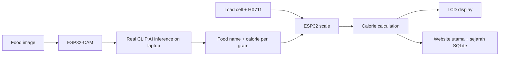

# Demo Flow

Gunakan skrip ini masa presentation supaya projek nampak jelas, yakin, dan berjaya.

## Ayat Ringkas Untuk Explain

Projek ini menggunakan ESP32-CAM untuk mengenal pasti jenis makanan, load cell untuk mengukur berat makanan, dan ESP32 untuk mengira anggaran kalori secara automatik. Formula yang digunakan ialah berat makanan dalam gram didarab dengan nilai kalori per gram daripada dataset makanan. Output dipaparkan pada LCD dan boleh dipantau melalui dashboard IoT.

## Block Diagram



## Demo Step

1. Hidupkan ESP32 scale.
2. Tunjuk LCD keluar `System ready`.
3. Buka Serial Monitor dan tunjuk IP ESP32 scale.
4. Jalankan `.\start_ai_server.ps1 -ScaleUrl "http://IP_PENIMBANG"`, tetapkan kata laluan dan tunggu `AI ready`.
5. Hidupkan ESP32-CAM. LED menyala ketika gambar sebenar diambil.
6. Tunjuk gambar dan confidence sebenar pada dashboard AI port 5000.
7. Letak makanan atas load cell.
8. Tunggu bacaan stabil sampai status `LOCK`.
9. LCD papar makanan, berat, dan kalori.
10. Pada website laptop port 5000, tunjuk rekod automatik dengan gambar, gram, kalori dan waktu makan.
11. Buka akses pentadbir menggunakan kata laluan. Tunjuk edit rekod dan tambah jenis makanan di Pangkalan kalori.
12. Tutup dan buka website semula untuk menunjukkan data masih tersimpan. Angkat makanan atau tare sebelum hidangan seterusnya.

## Contoh Output

```text
Food detected: Rice
Weight: 150.0 g
Calories: 195 kcal
Status: LOCKED
```

## Point Untuk Nampak Kuat

- Sistem ada real sensor reading, bukan hanya display palsu.
- Berat dikunci selepas stabil supaya bacaan nampak profesional.
- Detection makanan dihantar melalui WiFi API.
- Formula nutrisi mudah diterangkan dan boleh dikembangkan.
- Keputusan confidence rendah ditolak supaya sistem tidak memaparkan tekaan rawak.
- Semua pemantauan dan edit data melalui satu website; tiada Blynk.
- Data dan gambar disimpan dalam SQLite dan kekal selepas restart.

## Limitations Yang Boleh Disebut

- AI recognition boleh kurang tepat untuk makanan bercampur.
- Bacaan berat bergantung kepada calibration load cell.
- Internet/WiFi perlu stabil untuk dashboard dan AI server.
- Dataset kalori perlu diperbesarkan untuk penggunaan sebenar.

## Future Improvement

- Fine-tune model menggunakan gambar yang diambil daripada ESP32-CAM sendiri.
- Tambah database makanan Malaysia seperti nasi lemak, mee goreng, roti canai.
- Tambah nutrition detail seperti protein, carbohydrate, fat.
- Tambah sandaran cloud untuk sejarah makanan SQLite.
- Tambah akaun berasingan bagi pengguna berlainan.
